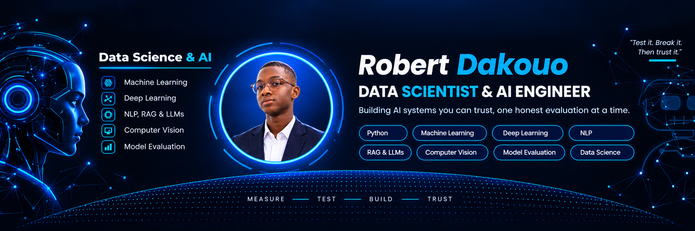

Readme · MD

  
 <h1 align="center">Hi, I'm Robert 👋</h1> 
  
 
    

🔭 About me
I am a final-year Data & AI engineering student. I like projects where the model has to face the real world: noisy data, shifted conditions, small datasets and honest evaluation.

🎓 Finishing my engineering thesis, CareerPilot AI, a career assistant built around RAG and LLMs
🧪 I care about one thing above all: a high score is a claim you still have to test
🌍 Looking for an internship in AI / Data in Dakar or Abidjan
"My model scored 1.00. Without the leak, the same model scored 0.675." That gap taught me more than any good score ever did.

🚀 Projects
Project	What it does
📡	3GPP-RAG	Retrieval-augmented question answering on telecom specifications (3GPP)
🌦️	Domain Shift in Object Detection (coming soon)	YOLOv8, Faster R-CNN, DETR and RT-DETR under degraded weather
🤝	Co-training, the leakage trap (coming soon)	Semi-supervised learning, 20 seeds, and why a perfect score was wrong
📰	Fake News Detection (coming soon)	NLP classifier for misleading news
🔤	Robustness of Word Embeddings (coming soon)	How embeddings behave when the text gets noisy
🎥	Online Proctoring with Facial 2FA (coming soon)	Face-based second factor for remote exams
🧰 Tools I work with

      

Focus areas: Machine Learning · Deep Learning · NLP · RAG & LLMs · Computer Vision · Model Evaluation

✅ My 12-step checklist before I trust a model
1 Define the goal · 2 Collect data · 3 Audit the data · 4 Clean it · 5 Split first · 6 Fit on train only · 7 Hunt for leaks · 8 Beat a baseline · 9 Use many seeds · 10 Read the errors · 11 Stress it · 12 Report honestly

📊 GitHub stats

   
 
<i>Before you believe a score, try to break it. 🔨</i>

Claude a terminé sa réponse.
